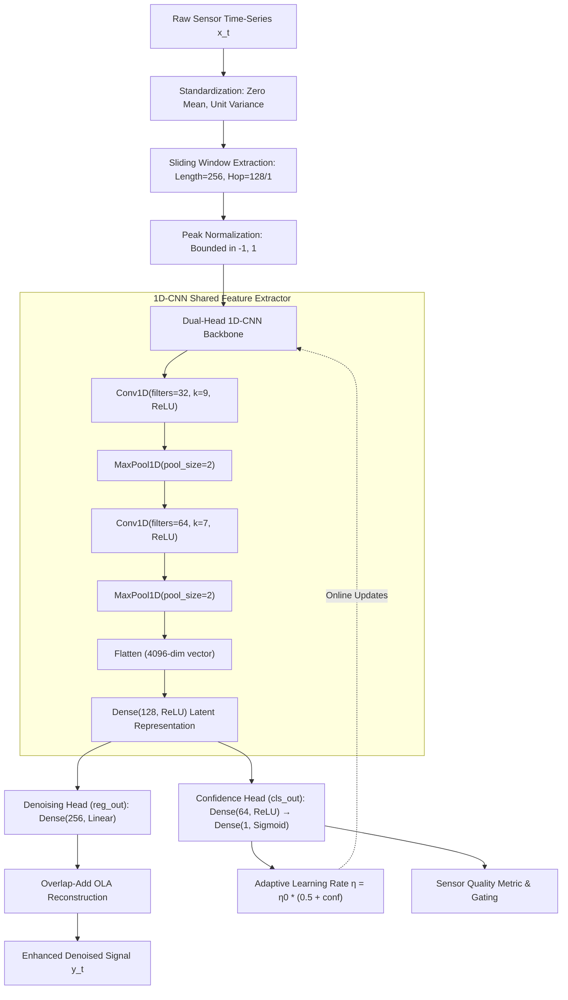

# System and Neural Network Architecture

This document provides a comprehensive technical breakdown of the hardware/software architecture, 1D-CNN multi-task topology, tensor shapes, and loss formulations.

---

## 1. System Architecture

The end-to-end signal processing architecture consists of five core stages:

```
[Raw Sensor Ingestion]
        │
        ▼
[Preprocessing & Framing] ──► Normalization (μ=0, σ=1) & 256-sample windowing
        │
        ▼
[1D-CNN Multi-Task Core] ──► Feature extraction across 2 Conv1D blocks & Dense latent space
        │
   ┌────┴──────────────────────────┐
   ▼                               ▼
[Regression Denoising Head]    [Classification Confidence Head]
   │ (256 linear samples)          │ (Sigmoid score ∈ [0, 1])
   ▼                               ▼
[Overlap-Add Reconstruction]   [Confidence-Guided Learning Rate Scaling]
   │                               │
   ▼                               ▼
[Denoised Output Signal]       [Online Parameter Adaptation Loop]
```

### Flowchart Representation (Mermaid)



---

## 2. Neural Network Topology & Tensor Dimensions

| Layer Index | Layer Name | Layer Type | Output Shape | Parameters | Activation | Description |
| :---: | :--- | :--- | :--- | :---: | :---: | :--- |
| 0 | `signal_input` | `InputLayer` | `(None, 256, 1)` | 0 | - | Raw 256-sample normalized window |
| 1 | `conv1d_1` | `Conv1D` | `(None, 256, 32)` | 320 | `ReLU` | 32 kernels of size 9, stride 1, padding same |
| 2 | `maxpool_1` | `MaxPooling1D` | `(None, 128, 32)` | 0 | - | Spatial downsampling (factor 2) |
| 3 | `conv1d_2` | `Conv1D` | `(None, 128, 64)` | 14,400 | `ReLU` | 64 kernels of size 7, stride 1, padding same |
| 4 | `maxpool_2` | `MaxPooling1D` | `(None, 64, 64)` | 0 | - | Spatial downsampling (factor 2) |
| 5 | `flatten` | `Flatten` | `(None, 4096)` | 0 | - | Feature vector flattening ($64 \times 64 = 4096$) |
| 6 | `shared_dense` | `Dense` | `(None, 128)` | 524,416 | `ReLU` | Shared latent manifold representation |
| **7a** | `reg_out` | `Dense` | `(None, 256)` | 33,024 | `Linear` | **Regression head**: clean waveform prediction |
| **7b** | `cls_dense` | `Dense` | `(None, 64)` | 8,256 | `ReLU` | Intermediate classification layer |
| **8b** | `cls_out` | `Dense` | `(None, 1)` | 65 | `Sigmoid` | **Confidence head**: signal probability $[0, 1]$ |
| - | **Total Parameters** | - | - | **580,481** | - | Trainable: 580,481 (2.21 MB in FP32) |

---

## 3. Mathematical Loss Formulation

The network is trained end-to-end using a joint multi-task objective function balancing waveform reconstruction accuracy and classification confidence:

$$\mathcal{L}_{\text{total}} = \lambda_{\text{reg}} \mathcal{L}_{\text{reg}} + \lambda_{\text{cls}} \mathcal{L}_{\text{cls}}$$

where:
- $\lambda_{\text{reg}} = 1.0$ and $\lambda_{\text{cls}} = 0.2$
- **Regression Loss ($\mathcal{L}_{\text{reg}}$):** Mean Squared Error over window length $L = 256$:
  $$\mathcal{L}_{\text{reg}} = \frac{1}{L} \sum_{i=1}^{L} \left( y_{\text{clean}}[i] - \hat{y}_{\text{clean}}[i] \right)^2$$
- **Classification Loss ($\mathcal{L}_{\text{cls}}$):** Binary Cross-Entropy over ground truth signal presence $c \in \{0, 1\}$:
  $$\mathcal{L}_{\text{cls}} = - \left( c \log \hat{c} + (1 - c) \log(1 - \hat{c}) \right)$$

---

## 4. Signal Reconstruction Strategy

In continuous inference mode, adjacent sliding windows are processed with single-sample stride ($H = 1$). To synthesize a smooth continuous time series without boundary discontinuities, the Overlap-Add (OLA) operator is defined as:

$$\hat{y}[n] = \frac{\sum_{i} \hat{w}_i[n - i]}{\sum_{i} \mathbf{1}_{i}[n]}$$

where $\hat{w}_i$ represents the model's regression output for the $i$-th sliding window and the denominator normalizes the accumulated sample overlaps.
