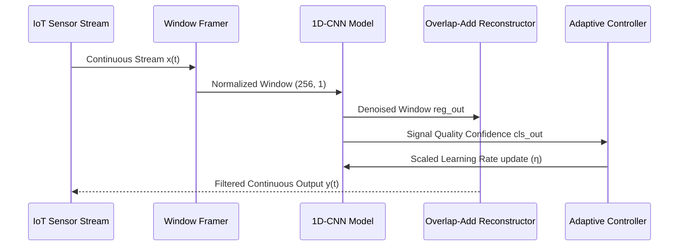

# Research Methodology and Algorithmic Formulations

This document describes the theoretical foundations, adaptive filtering baselines, confidence-guided incremental adaptation mechanisms, and evaluation metrics.

---

## 1. Classical Adaptive Filtering Foundations

Traditional sensor denoising relies on stochastic gradient adaptive filters such as the Least Mean Squares (LMS) and Normalized Least Mean Squares (NLMS) algorithms.

### Least Mean Squares (LMS)

For input vector $\mathbf{x}[n]$ and desired reference $d[n]$, the LMS filter computes:

$$\hat{y}[n] = \mathbf{w}^T[n] \mathbf{x}[n]$$
$$e[n] = d[n] - \hat{y}[n]$$
$$\mathbf{w}[n+1] = \mathbf{w}[n] + 2 \mu e[n] \mathbf{x}[n]$$

where $\mu$ is the learning step size.

### Normalized Least Mean Squares (NLMS)

To prevent instability caused by fluctuating input energy, NLMS normalizes the gradient update by the signal squared Euclidean norm:

$$\mathbf{w}[n+1] = \mathbf{w}[n] + \frac{\mu}{\|\mathbf{x}[n]\|^2 + \epsilon} e[n] \mathbf{x}[n]$$

where $\epsilon > 0$ is a small regularization constant.

### Theoretical Limitations of Linear Filters
1. **Linearity Assumption:** LMS/NLMS assume a linear transfer function between reference and observed noise. They fail under non-linear transducer distortion, power amplifier clipping, and non-linear harmonic generation.
2. **Impulse Sensitivity:** Large shot noise or electromagnetic discharge spikes induce massive error gradients $e[n]$, causing catastrophic coefficient divergence or transient ringing.
3. **Tracking vs. Misadjustment Tradeoff:** Fast tracking (large $\mu$) results in high steady-state excess mean squared error (EMSE), while small $\mu$ yields unacceptable convergence latency during sudden signal transitions.

---

## 2. Confidence-Aware Deep Learning Framework

To resolve these limitations, the proposed framework couples non-linear feature representations via deep 1D convolutions with an explicit confidence classification mechanism.

---

## 3. Confidence-Guided Incremental Adaptation

In practical embedded IoT monitoring, signal characteristics drift over time due to battery decay, temperature fluctuations, and environmental alterations. 

Rather than executing unconstrained online gradient descent (which leads to catastrophic forgetting or overfitting to noise bursts), the online adapter scales its learning rate dynamically proportional to the model's confidence in signal presence:

$$\eta[n] = \eta_0 \left(0.5 + \hat{c}[n]\right)$$

where:
- $\eta_0$ is the base online learning rate (nominal: $10^{-5}$)
- $\hat{c}[n] \in [0, 1]$ is the output of the sigmoid classification head `cls_out`

### Adaptation Dynamics:
- **High-Quality Signal ($\hat{c} \approx 1.0$):** $\eta[n] \to 1.5 \eta_0$. The model actively updates weights to track legitimate sensor drifts.
- **Pure Noise Burst ($\hat{c} \approx 0.0$):** $\eta[n] \to 0.5 \eta_0$. The update rate is attenuated by 66%, shielding the latent representations from being corrupted by transient noise artifacts.

---

## 4. Evaluation Metrics Formulation

### Signal-to-Noise Ratio (SNR)

To evaluate noise attenuation without amplitude scaling bias, the processed signal $\hat{\mathbf{y}}$ is rescaled to match the peak dynamic range of the clean reference $\mathbf{y}$:

$$\alpha = \frac{\max(|\mathbf{y}|)}{\max(|\hat{\mathbf{y}}|) + \epsilon}$$
$$\mathbf{y}_{\text{proc}} = \alpha \cdot \hat{\mathbf{y}}$$
$$\mathbf{n}_{\text{residual}} = \mathbf{y} - \mathbf{y}_{\text{proc}}$$

$$\text{SNR}_{\text{dB}} = 10 \log_{10} \left( \frac{\sum_{i=1}^N y_i^2}{\sum_{i=1}^N n_{\text{residual}, i}^2 + \epsilon} \right)$$

### Mean Squared Error (MSE)

$$\text{MSE} = \frac{1}{N} \sum_{i=1}^N \left( y_i - \hat{y}_i \right)^2$$
